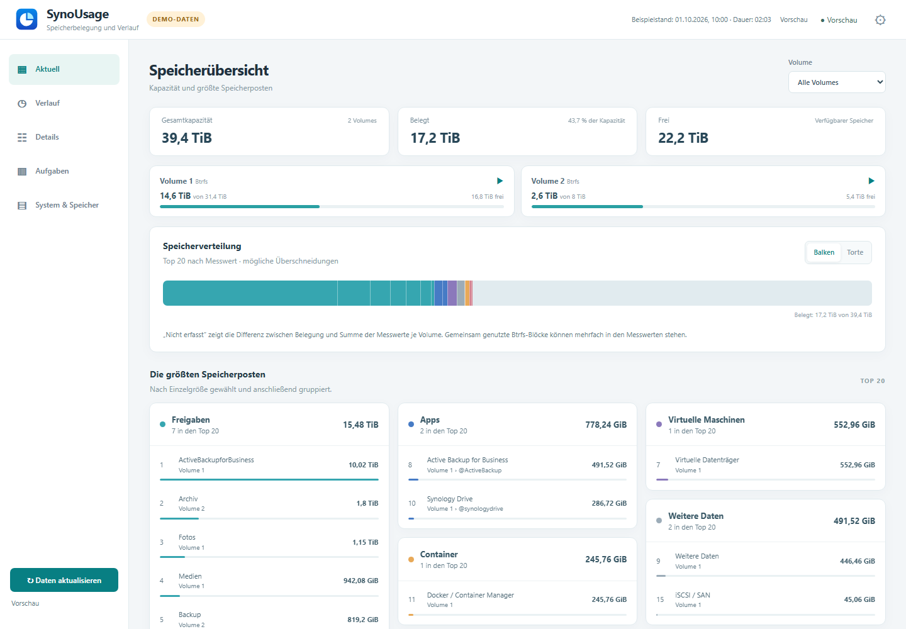

# SynoUsage

<b>Deutsch</b>

SynoUsage zeigt die Speicherbelegung eines Synology-NAS, frühere Messstände und den erkannten Speicheraufbau. Neben Freigaben berücksichtigt es unter anderem App-Verzeichnisse, Snapshots und – soweit vorhanden – virtuelle Datenträger und Container.

**Voraussetzungen:** DSM 7.1-42661 oder neuer und ein 64-Bit-Intel- oder AMD-System (`x86_64`). ARM wird derzeit nicht unterstützt. Für die Einrichtung der Erfassung wird ein DSM-Administratorkonto benötigt.

**Teststand:** Auf einer DS918+ (`apollolake`) wurden Installation und Erfassung unter DSM 7.1.1 und 7.2.2 erprobt. Unter 7.2.2 musste die Erfassungsaufgabe auf einem getesteten NAS manuell angelegt werden. Weitere Tests unter DSM 7.3.2 und 7.4.1 sowie mit Virtual DSM sind geplant. Die verfügbaren Hardware- und Speicherinformationen können je nach System abweichen.

**Einrichtung:**

1. Das SPK im Paket-Zentrum über **Manuelle Installation** installieren und SynoUsage aus dem DSM-Hauptmenü öffnen.
2. In den Einstellungen unter **Datenerhebung** die Aufgabe registrieren. Falls DSM dies ablehnt, das dort angebotene Skript im DSM-Aufgabenplaner als benutzerdefinierte Aufgabe für `root` anlegen.
3. Mit **Daten aktualisieren** die erste Erfassung starten. Bis zum ersten Ergebnis zeigt SynoUsage gekennzeichnete Beispieldaten. Für regelmäßige Erfassungen den Zeitplan im Aufgabenplaner aktivieren.

Die Oberfläche ist momentan auf Deutsch. Eine englische Übersetzung ist geplant.

---

<b>English</b>

SynoUsage displays storage usage, previous measurements and the detected storage layout of a Synology NAS. In addition to shared folders, it can account for application directories, snapshots, and, where available, virtual disks and containers.

**Requirements:** DSM 7.1-42661 or later and a 64-bit Intel or AMD system (`x86_64`). ARM is not currently supported. A DSM administrator account is required to set up collection.

**Testing:** Installation and collection have been tried on a DS918+ (`apollolake`) with DSM 7.1.1 and 7.2.2. On one NAS running 7.2.2 the collection task had to be created manually. Further testing on DSM 7.3.2 and 7.4.1 and with Virtual DSM is planned. Available hardware and storage information may vary by system.

**Setup:**

1. Install the SPK using **Manual Install** in Package Center and open SynoUsage from the DSM main menu.
2. In settings, register the collection task under **Datenerhebung**. If DSM rejects registration, create a user-defined task for `root` in DSM Task Scheduler using the script offered in the settings.
3. Select **Daten aktualisieren** to start the first collection. Until it finishes, SynoUsage displays labelled sample data. Enable the schedule in Task Scheduler for regular collections.

The interface is currently in German; an English translation is planned.

---

Technische Informationen und Build-Anleitung / Technical information and build instructions: [README](../README.md)
